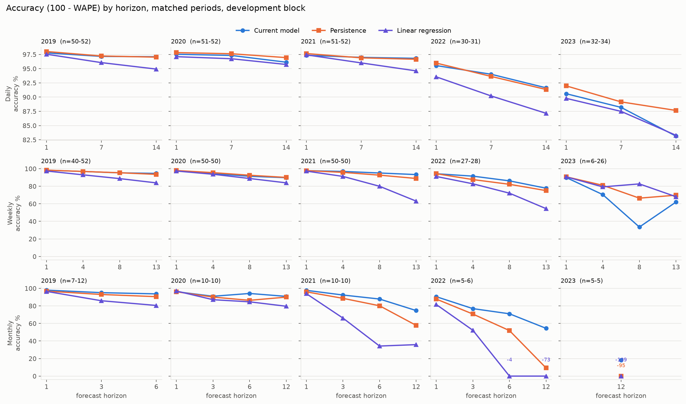
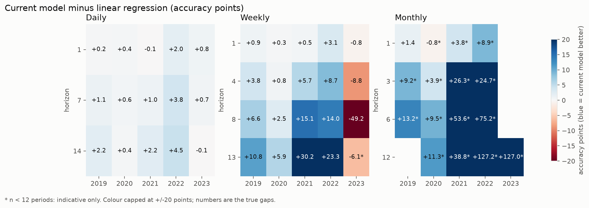
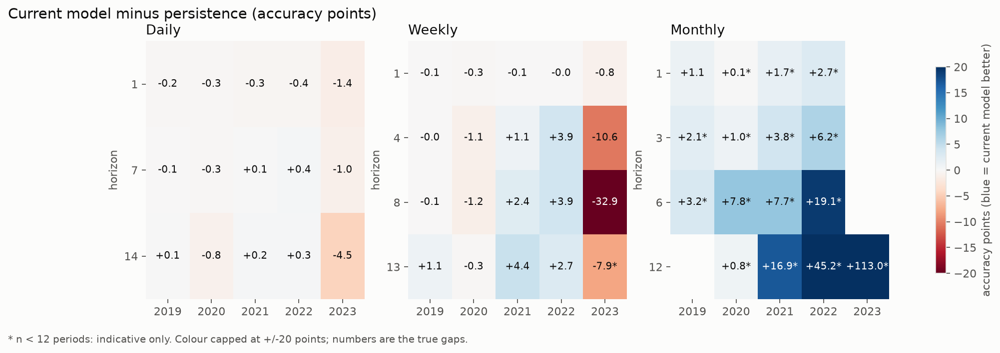
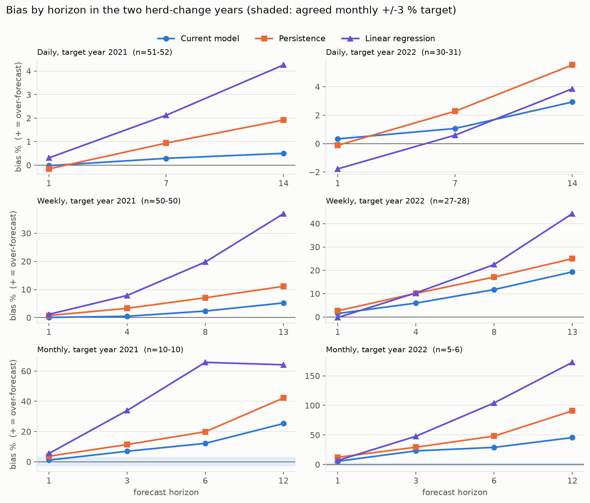
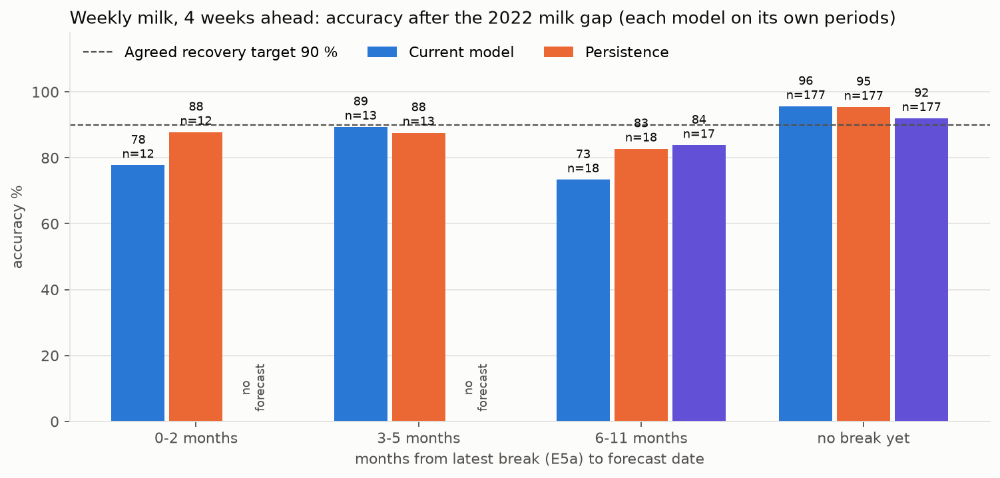
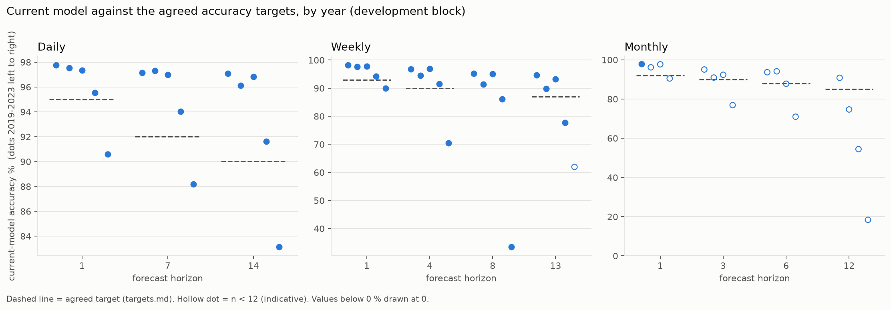

# PP1 evidence pack: why the current structural milk model

Component 1 (PFOI), Farm X, herd level only. Current model = `milk_baseline_adaptive`
(pfoi-1.1 research candidate: 12-month window, known-data cutoffs, herd-fitted curves,
anchored k, adaptive level correction). Generated by `docs/build_evidence_pack.py` from
`docs/data/linear_baseline_wape.csv` and `docs/data/recovery_weekly_h4_E5a.csv`. Every figure and table number comes from those files, except the benchmark ratios quoted from `pp1_results.md`.

**Notebook.** `notebooks/02_current_model_evidence.ipynb` reproduces every table and chart below from the same CSVs.

**Status labels.** *Evaluated* = the user ran it and sent aggregates (development block, origins
2019-2023, rolling refit, identical periods per row). *Post-hoc* (2024-2026) = not run yet.
*Implemented-and-tested* = synthetic tests only. *Not run* = no result.
Accuracy = 100 - WAPE. Skill vs persistence = 1 - MAE(current) / MAE(persistence) on the same periods.
`\*` = n < 12, indicative only.

## (a) Comparison table (evaluated, development block, matched periods)

Models in the table: linear regression, ridge, persistence, current. **ETS, SARIMA and seasonal naive are
not in this table**: the experiment runs score them on different period sets from the current model, so a
matched comparison needs the scorecard run in section (e). Their earlier, matched development results
are quoted below (pfoi-1.0.0-era common periods, `pp1_results.md`): monthly milk MAE ratio to persistence,
horizons 1/3/6/12 = ETS 1.38/1.63/2.02/2.05, seasonal naive 3.78/1.62/1.09/1.00, PFOI baseline
0.62/0.63/0.61/0.75; SARIMA ran on only 24 months (1.12/1.01/1.00/0.99 against 0.69/0.90/0.82/0.81).
Skill against the **best** benchmark is therefore not claimed here; skill vs persistence is a lower bound on
how hard the benchmark is to beat only where persistence is the best benchmark.

### Daily (issued weekly; horizons in days)
| Horizon | Year | n | Linear | Ridge | Persistence | **Current** | Bias cur / lin / pers % | Skill vs persistence | Target |
|---|---|---|---|---|---|---|---|---|---|
| 1 | 2019 | 52 | 97.5 | 88.5 | 98.0 | **97.8** | -0.0 / -0.5 / -0.1 | -0.12 | 95 % met |
| 1 | 2020 | 51 | 97.1 | 88.6 | 97.8 | **97.5** | +0.2 / +0.9 / +0.7 | -0.13 | 95 % met |
| 1 | 2021 | 51 | 97.4 | 87.3 | 97.7 | **97.3** | -0.0 / +0.3 / -0.2 | -0.13 | 95 % met |
| 1 | 2022 | 31 | 93.6 | 48.3 | 96.0 | **95.5** | +0.3 / -1.8 / -0.1 | -0.11 | 95 % met |
| 1 | 2023 | 34 | 89.8 | 86.7 | 92.0 | **90.6** | +1.9 / -0.7 / +0.2 | -0.17 | 95 % missed |
| 7 | 2019 | 51 | 96.1 | 88.2 | 97.2 | **97.2** | -0.3 / -0.4 / -0.3 | -0.03 | 92 % met |
| 7 | 2020 | 52 | 96.7 | 88.5 | 97.6 | **97.3** | +0.4 / +0.7 / +0.2 | -0.12 | 92 % met |
| 7 | 2021 | 52 | 96.0 | 87.0 | 96.9 | **97.0** | +0.3 / +2.1 / +0.9 | +0.03 | 92 % met |
| 7 | 2022 | 30 | 90.2 | 38.7 | 93.6 | **94.0** | +1.1 / +0.6 / +2.3 | +0.06 | 92 % met |
| 7 | 2023 | 34 | 87.5 | 86.0 | 89.2 | **88.2** | +1.0 / +0.1 / -3.5 | -0.09 | 92 % missed |
| 14 | 2019 | 50 | 94.9 | 88.1 | 97.0 | **97.1** | -0.5 / +0.1 / -0.5 | +0.02 | 90 % met |
| 14 | 2020 | 52 | 95.7 | 88.0 | 96.9 | **96.1** | +0.7 / +1.2 / +0.7 | -0.26 | 90 % met |
| 14 | 2021 | 52 | 94.6 | 85.6 | 96.7 | **96.8** | +0.5 / +4.3 / +1.9 | +0.05 | 90 % met |
| 14 | 2022 | 31 | 87.2 | 36.5 | 91.3 | **91.6** | +2.9 / +3.9 / +5.5 | +0.03 | 90 % met |
| 14 | 2023 | 32 | 83.3 | 85.0 | 87.7 | **83.1** | +3.5 / +4.6 / -3.3 | -0.37 | 90 % missed |

### Weekly (horizons in weeks)
| Horizon | Year | n | Linear | Ridge | Persistence | **Current** | Bias cur / lin / pers % | Skill vs persistence | Target |
|---|---|---|---|---|---|---|---|---|---|
| 1 | 2019 | 52 | 97.4 | 88.7 | 98.4 | **98.3** | -0.2 / -0.3 / -0.1 | -0.06 | 93 % met |
| 1 | 2020 | 50 | 97.3 | 88.7 | 97.9 | **97.6** | +0.5 / +1.0 / +0.8 | -0.13 | 93 % met |
| 1 | 2021 | 50 | 97.3 | 87.0 | 97.8 | **97.8** | +0.1 / +1.2 / +0.8 | -0.03 | 93 % met |
| 1 | 2022 | 27 | 91.1 | 39.5 | 94.3 | **94.3** | +1.5 / -0.3 / +2.6 | -0.01 | 93 % met |
| 1 | 2023 | 26 | 90.7 | 87.9 | 90.8 | **90.0** | +2.8 / +1.5 / -1.0 | -0.09 | 93 % missed |
| 4 | 2019 | 49 | 93.0 | 87.7 | 96.9 | **96.8** | -0.8 / +1.2 / -0.7 | -0.00 | 90 % met |
| 4 | 2020 | 50 | 93.7 | 87.3 | 95.5 | **94.4** | +1.6 / +2.8 / +2.5 | -0.24 | 90 % met |
| 4 | 2021 | 50 | 91.2 | 82.7 | 95.8 | **96.9** | +0.5 / +7.9 / +3.3 | +0.25 | 90 % met |
| 4 | 2022 | 28 | 82.8 | 21.7 | 87.6 | **91.5** | +5.9 / +10.3 / +10.1 | +0.32 | 90 % met |
| 4 | 2023 | 20 | 79.3 | 82.4 | 81.1 | **70.5** | +8.5 / +4.4 / -2.4 | -0.56 | 90 % missed |
| 8 | 2019 | 45 | 88.7 | 87.9 | 95.4 | **95.3** | -0.7 / +5.9 / -1.2 | -0.02 | no target |
| 8 | 2020 | 50 | 88.8 | 86.3 | 92.5 | **91.4** | +1.9 / +4.7 / +4.1 | -0.16 | no target |
| 8 | 2021 | 50 | 80.0 | 75.1 | 92.6 | **95.1** | +2.3 / +19.8 / +7.1 | +0.33 | no target |
| 8 | 2022 | 28 | 72.1 | -28.4 | 82.2 | **86.1** | +11.7 / +22.4 / +17.1 | +0.22 | no target |
| 8 | 2023 | 13 | 82.7 | 76.0 | 66.4 | **33.5** | +16.1 / -7.8 / -8.4 | -0.98 | no target |
| 13 | 2019 | 40 | 83.8 | 88.4 | 93.5 | **94.6** | -0.2 / +12.5 / -1.8 | +0.17 | 87 % met |
| 13 | 2020 | 50 | 83.9 | 84.3 | 90.1 | **89.8** | +2.0 / +7.4 / +5.4 | -0.03 | 87 % met |
| 13 | 2021 | 50 | 63.1 | 64.9 | 88.9 | **93.3** | +5.2 / +36.9 / +11.1 | +0.40 | 87 % met |
| 13 | 2022 | 28 | 54.5 | -61.4 | 75.0 | **77.8** | +19.3 / +44.2 / +25.0 | +0.11 | 87 % missed |
| 13 | 2023 | 6 \* | 68.1 | 81.8 | 69.8 | **62.0** | +1.8 / +26.8 / +8.4 | -0.26 | 87 % missed |

### Monthly (horizons in months)
| Horizon | Year | n | Linear | Ridge | Persistence | **Current** | Bias cur / lin / pers % | Skill vs persistence | Target |
|---|---|---|---|---|---|---|---|---|---|
| 1 | 2019 | 12 | 96.5 | 86.6 | 96.8 | **97.9** | -0.2 / +1.7 / -0.2 | +0.35 | 92 % met |
| 1 | 2020 | 10 \* | 96.9 | 87.6 | 96.1 | **96.2** | +1.0 / +2.1 / +2.1 | +0.02 | 92 % met |
| 1 | 2021 | 10 \* | 93.9 | 63.6 | 96.0 | **97.7** | +1.1 / +5.5 / +3.7 | +0.42 | 92 % met |
| 1 | 2022 | 5 \* | 81.6 | 18.1 | 87.8 | **90.5** | +5.5 / +6.8 / +12.2 | +0.22 | 92 % missed |
| 3 | 2019 | 10 \* | 85.9 | 87.9 | 93.0 | **95.1** | +0.5 / +11.1 / -0.0 | +0.30 | 90 % met |
| 3 | 2020 | 10 \* | 87.0 | 87.3 | 90.0 | **91.0** | +2.2 / +4.3 / +4.8 | +0.10 | 90 % met |
| 3 | 2021 | 10 \* | 66.1 | 51.9 | 88.6 | **92.4** | +7.0 / +33.9 / +11.4 | +0.33 | 90 % met |
| 3 | 2022 | 5 \* | 52.2 | -9.0 | 70.7 | **76.9** | +23.1 / +47.8 / +29.3 | +0.21 | 90 % missed |
| 6 | 2019 | 7 \* | 80.5 | 89.2 | 90.5 | **93.7** | +4.7 / +19.3 / -0.9 | +0.33 | 88 % met |
| 6 | 2020 | 10 \* | 84.6 | 86.3 | 86.3 | **94.1** | +3.8 / +9.3 / +4.7 | +0.57 | 88 % met |
| 6 | 2021 | 10 \* | 34.2 | 37.2 | 80.1 | **87.8** | +12.2 / +65.8 / +19.9 | +0.39 | 88 % missed |
| 6 | 2022 | 6 \* | -4.2 | -72.4 | 51.9 | **71.0** | +29.0 / +104.2 / +48.1 | +0.40 | 88 % missed |
| 12 | 2020 | 10 \* | 79.6 | 85.1 | 90.0 | **90.8** | -7.9 / +13.0 / +3.0 | +0.08 | 85 % met |
| 12 | 2021 | 10 \* | 35.9 | 37.6 | 57.8 | **74.7** | +25.3 / +64.1 / +42.2 | +0.40 | 85 % missed |
| 12 | 2022 | 6 \* | -72.7 | -69.6 | 9.3 | **54.4** | +45.6 / +172.7 / +90.7 | +0.50 | 85 % missed |
| 12 | 2023 | 5 \* | -108.6 | -441.4 | -94.7 | **18.4** | +81.6 / +208.6 / +194.7 | +0.58 | 85 % missed |

Bias is positive = over-forecast. Monthly 12-month 2019 and 6-month 2023 (n = 1) are left out.

## Figures

| File | Caption (what it shows, n) |
|---|---|
|  | [fig1](figures/fig1_accuracy_by_horizon.png): accuracy against horizon, 3 grains x 5 years; n per panel in the titles (6-52) |
|  | [fig2](figures/fig2_current_minus_linear.png): current minus linear, accuracy points; 44 of 51 cells favour the current model |
|  | [fig3](figures/fig3_current_minus_persistence.png): current minus persistence; shows where persistence is as good |
|  | [fig4](figures/fig4_bias_herd_change_years.png): bias by horizon in 2021 and 2022 (n 5-52); shaded = agreed monthly +/-3 % |
|  | [fig5](figures/fig5_recovery_weekly_h4.png): weekly 4-week accuracy after break E5a; n 12-177, each model on its own periods |
|  | [fig6](figures/fig6_accuracy_vs_targets.png): current accuracy against `targets.md`, per year; hollow = n < 12 |

Palette checked with `docs/tools/validate_palette.py` (blue = current, orange = persistence, violet = linear).

## (b) Six bullets for the slide (each checked against the table above)

1. **Beats a plain linear regression almost everywhere:** at least as accurate in 44 of 51 cells. In the
   herd-change years 2021-22 it is 5.7 to 30.2 points ahead at weekly 4+ weeks (monthly cells all have n < 12 and show larger gaps).
2. **Beats persistence on all 16 monthly cells,** by +0.1 to +113.0 points (median +3.5).
   Monthly cells have 5-12 periods each (1 of 16 reach 12), so read this as consistent direction, not precise size.
3. **From 4 weeks ahead the weekly picture is mixed:** within 1.2 points of persistence in 2019-2020,
   +1.1 to +4.4 in 2021-22, and -32.9 to -7.9 in 2023 (n 6-20, indicative).
4. **Bias is smaller than linear's** when the herd changed (monthly 2021 6 months: current
   +12.2 % vs linear +65.8 %).
   It is **not** inside the agreed +/-3 % monthly target in 11 of 16 monthly cells.
5. **Explained by construction:** every milk change splits into herd size, parity, stage, pregnancy and yield level, with
   parts that add up exactly (`attribution.py`, tested on synthetic data; implemented-and-tested).
6. **Predeclared yardstick:** accuracy, skill, bias and coverage targets were frozen before measuring (`targets.md`);
   the current model meets the accuracy target in 32 of 46 year-cells with a target (24 of 30 with n >= 12).
   Persistence meets it in 29 (23 of 30) and linear in 18, so the accuracy targets alone do not separate the current model from persistence; skill against persistence and bias matter more.

## (c) Limits slide (state plainly)

- **Short range:** persistence is as good or better at 1 day to 1 week (persistence is ahead in 13 of 15
  cells at daily 1, 7 days and weekly 1 week). The value claim starts at about 4 weeks.
- **2023 weekly weakness:** accuracy 4 wk 70.5 % (n=20), 8 wk 33.5 % (n=13),
  against persistence 81.1 %, 66.4 % and linear
  79.3 %, 82.7 %. Linear only has forecasts where it had at least 24
  completed same-source examples, so that comparison is a favourable subset. Cause not yet diagnosed.
- **Recovery after a break is not better than persistence:** weekly 4 weeks, 0-2 months after break E5a, current
  77.8 % (n=12) against persistence 87.8 %; agreed target 90 % is **not met**.
- **Bias target:** monthly |bias| <= 3 % holds in 5 of 16 monthly cells.
- **Not confirmation:** development block only. 2024-2026 results are post-hoc; only prospective months after 2026-08-20 confirm.
  The monthly post-hoc run is **not run** (first attempt failed on a source setting, fixed in `forecast_experiments.py`).
- **Not yet evaluated:** boosted, TCN and residual-TCN candidates (implemented, no run results), so no superiority claim over them.
- **Intervals:** pfoi-1.0.0 90 % ranges covered 34-83 % (`intervals.py` doc). The adaptive-conformal intervals are
  implemented-and-tested on synthetic data; real-data coverage for the current model has not been supplied.
- **Data quality:** the 2024-26 block is mostly gap or unverified; ETL issues (about 29 % of milked cows with no open lactation in mid-2026)
  limit what can be tested (`targets.md`).
- **Replay, not as-published:** history may contain retrospective ETL revisions.

## (d) Likely panel questions and short, truthful answers

**Why not just linear regression?** Matched on the same periods, linear is within about 1-3 points of the current
model up to a week, then falls behind: 5.7 to 30.2 points behind at weekly 4+ weeks and monthly 3+
months in 2021-22, with bias up to 208.6 % (current 81.6 %). It also cannot explain a change or forecast calvings.
It does win in the small 2023 weekly subset (see limits).

**Why not deep learning?** Boosted trees and a causal TCN (direct and residual) are implemented in the same rolling harness,
but there are **no results yet**, so we claim nothing against them. Ridge on 426 raw inputs, the nearest regularised model,
scored worse than linear everywhere. The plan (`error_diagnostics_and_model_comparison.md`) is to compare them after targets are frozen.

**Why not persistence?** At 1 day to 1 week persistence is as good; we say so. It wins on 4+ weeks monthly cells everywhere
and weekly in 2021-22, but its real limit is that it cannot explain anything or forecast events: in development the herd model forecasts
calvings 4-6 times better than persistence at 3-6 months (`pp1_results.md`, evaluated, pfoi-1.0.0).

**What happens after an outage?** Honestly, slowly: the agreed recovery target is 90 % at 0-2 months and the current model
reaches 77.8 % (persistence 87.8 %). Mitigations exist (anchored k, quality bands, wider intervals) but are not shown to meet the target.

**Is 2023 a problem?** Yes, at weekly 4-13 weeks the current model is worse than persistence and, on the subset linear covers, than linear.
We will diagnose it with `error_diagnostics` before making a 2023 claim.

**How do you know there is no leakage?** We do not claim proof. Evaluated and tested: every loader filters to before the origin
(L1), conception rates use only confirmable months (L2), errors for corrections and intervals use only finished targets (L8). Still open or asked of the ETL:
L3-L6 (pregnant counts, conception dates, late-entered records, reliability flags). Design choices were made on the development block (L9).

**What is new versus St-Pierre 2001 and Gong 2025?** Those are the foundation. The contribution claimed, modestly, is that every past and future
point and every revision is explained by construction (exact Shapley split), and that uncertainty is meant to reflect record quality
(quality-banded adaptive-conformal intervals; implemented-and-tested, real-data coverage pending).

## (e) Claims I could not support, and the commands to close them (aggregate output only)

| Claim | Why unsupported | Command (you run it) |
|---|---|---|
| "Skill against the best benchmark" | ETS, SARIMA, seasonal naive are not matched to the current model in the experiment output | `$PFOI.cli scorecard --block development --preset pfoi-1.1 --k anchor_first` |
| "Recovers faster after breaks" | Weekly 4-week 0-2 months after E5a: current below persistence | none; it is a finding (report it) |
| "Bias is small" | |bias| <= 3 % holds in 5 of 16 monthly cells | none; report it |
| "Calibrated intervals" | No real-data coverage for the current model supplied | `$PFOI.cli scorecard --block development --preset pfoi-1.1 --k anchor_first --intervals aci` |
| "Better than boosted / TCN" | Not run | `python -W ignore -m components.predictive_farm_intelligence.pfoi.forecast_experiments --block development --start 2019-01-01 --end 2024-01-01 --grain monthly --models boosted tcn tcn_residual --structural-tag herd_fitted_p1_g0_ka_w12_ck_kn_rk_lag90_adhq0.1t365z3 --saved logs/pfoi_1_1_clean --out logs/pfoi_experiments/dev_monthly_ml` |
| Any 2024-2026 statement | Post-hoc run not completed | the post-hoc command in `linear_baseline.md` |
| Cause of the 2023 weekly weakness | Not diagnosed | `python -m components.predictive_farm_intelligence.pfoi.error_diagnostics --tag herd_fitted_p1_g0_ka_w12_ck_kn_rk_lag90_adhq0.1t365z3 --model milk_baseline_adaptive --herd-tag w12_ck_kn_rk_lag90 --quality on --out logs/pfoi_1_1_clean` |

Replace `$PFOI` with `python -m components.predictive_farm_intelligence.pfoi`.
