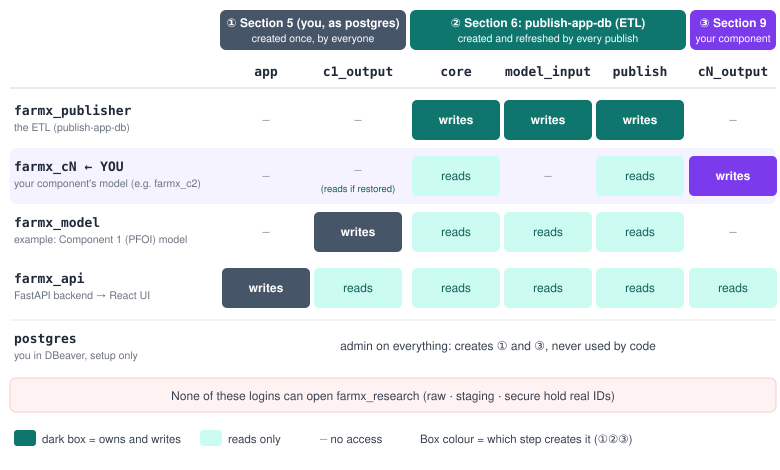

# Farm X app database (`farmx_app`): setup and schemas

How to create the database that the research components and the backend use, fill it
from the ETL, and connect to it. `core` is shared by every component; each component
has its **own** output schema and login (section 9). Written for this monorepo; the ETL
has its own setup guide (`research-etl-data-integration/docs/setup.md`).

> **Before you start: know your component number.** This guide is for every
> component. Wherever it says **`N`** or **`cN`**, use **your own** component number
> (agreed in the team, e.g. `2` → `farmx_c2`, `c2_output`). Commands that show
> `c2` are templates: replace `c2` with your `cN` before running them.
>
> **Component 1 (Predictive Farm Outlook Intelligence, PFOI)** appears only as a
> worked example, because it was set up first. It differs from the pattern in two ways:
> its login is named `farmx_model` (not `farmx_c1`), and it alone has an extra input
> schema, `model_input`. If you are not on Component 1, do **not** write to `c1_output`
> or use the `farmx_model` login for your own work.

## Step 0: update `core` in the ETL first (before any setup below)

`core` has had recent changes, so rebuild it before you do anything else. In the ETL
repo (`research-etl-data-integration`), with `FARMX_PSEUDO_KEY` exported in the same
terminal (never in `.env`), run:

```bash
python main.py build-core --rebuild-approved
```

- `--rebuild-approved` lets it replace the existing `core` tables; the secure key maps and
  group roles are kept.
- Then continue with section 0.
- Whenever the ETL changes again, re-run this and then `publish-app-db` (section 6).

## At a glance: what you create, in order, and who can access what



**What gets created, in this order**

0. **Update `core` first** (ETL repo): `python main.py build-core --rebuild-approved`
   (see Step 0 above).
1. **Logins + database** (section 3, you as `postgres`): `farmx_publisher`,
   `farmx_model`, `farmx_api`, and the empty database `farmx_app`.
2. **① Shared schemas** (section 5, you as `postgres`, same for everyone): `app`
   (backend) and `c1_output` (Component 1's results). `public` is locked.
3. **② Published data** (section 6, the ETL's `publish-app-db`): `core`, `model_input`,
   `publish`. Re-created on every publish.
4. **③ Your component** (section 9, you as `postgres`): your login `farmx_cN` and your
   schema `cN_output`. Component 1 skips this; its login and schema exist from 1–2.
5. **Optional, teammates' results** (section 10): restore their `cX_output` dump
   read-only.

**Who can do what**

- `farmx_publisher` (the ETL): writes `core`, `model_input`, `publish`. Nothing else.
- `farmx_cN` (**you**): reads `core` and `publish`; writes only your `cN_output`.
- `farmx_model` (example, Component 1): reads `core`, `model_input`, `publish`; writes
  only `c1_output`.
- `farmx_api` (backend): reads everything above; writes only `app`.
- `postgres` (you in DBeaver): setup only; never put it in code or a `.env`.
- No login here can open `farmx_research`, where the real IDs are.

## Do not give AI agents database access

Never give Claude Code, Codex or any other AI agent access to PostgreSQL or SQL Server.

- Run every database command yourself (DBeaver, `psql`, the ETL's `main.py`, model jobs
  that read real data). Do not let an agent run them.
- Do not share `.env`, passwords or connection details with an agent, and do not add
  database connections (MCP servers, IDE or DBeaver plugins) to an agent.
- If an agent needs a check, it gives you the SQL; you run it and reply with the
  **aggregate** result (counts, sums, min/max, percentages). Never paste or screenshot
  individual rows, keys or names, and crop password fields out of screenshots.
- The root `AGENTS.md` gives agents the same rule.

## In plain words: two databases, several logins, several schemas

**Two databases.**

- `farmx_research` is the **workshop**. The ETL builds it from DelPro, and part of it
  (`raw`, `staging`, `secure`) still holds real animal numbers and names. Only the ETL
  uses it.
- `farmx_app` is the **shop window**. It holds only a pseudonymised copy (`core`,
  `model_input`) that the ETL copies across with `publish-app-db`. Models and the backend
  use only this database.

None of the app logins can open `farmx_research`, so a bug or a leaked app password can
never reach real IDs. Rebuilding the ETL also never breaks the running app: the app keeps
the last published copy until you publish again.

**Several logins: one per program, each with its own key.** Think of each login as a
key that opens only some rooms:

| Login | Used by | Can read | Can write |
|---|---|---|---|
| `farmx_publisher` | the ETL, when you run `publish-app-db` | – | `core`, `model_input`, `publish` |
| `farmx_cN` (**your** component N, e.g. `farmx_c2`) | your component's model code (section 9) | `core` | your `cN_output` only |
| `farmx_model` (example: Component 1, PFOI) | Component 1's model code | `core`, `model_input` | `c1_output` only |
| `farmx_api` | the FastAPI backend | everything published | `app` only |
| `postgres` | you, in DBeaver, for setup | everything | everything |

So a model can't damage the published data or another component's results, and the
backend can't change any model's results. Each login has its **own password**.

**Several schemas: one folder per job** inside `farmx_app`:

| Schema | What is in it | Filled by |
|---|---|---|
| `core` | the shared pseudonymised dataset; every component reads it | ETL (`publish-app-db`) |
| `cN_output` (**yours**, e.g. `c2_output`) | your component's results | your model (`farmx_cN`) |
| `c1_output` (example: Component 1) | Component 1's forecasts | Component 1's model (`farmx_model`) |
| `model_input` | extra input for Component 1 only (herd panels) | ETL (`publish-app-db`) |
| `app` | the backend's own tables (users, saved scenarios, …) | backend (`farmx_api`) |
| `publish` | a log of each publish (version, row counts) | ETL |
| `public` | nothing; locked | – |

**How it connects to the app:**

```
ETL ──publish-app-db──▶ core, model_input
                              │  each component's model reads them
                              ▼
                  c1_output, c2_output, … cN_output   (each component writes only its own)
                              │  backend (farmx_api) reads them
                              ▼
                     FastAPI backend ──▶ React UI
```

## 0. New team member: setup order

Each authorised team member builds their own copy on their own machine. **Everyone**
does every step, whichever component they work on. Steps 1–2 are the same for all;
step 3 is where you use your own component number. (The publish step needs the
`farmx_model` and `farmx_api` logins to exist on every machine, so you create them even
if you are not on Component 1.)

1. **ETL repo** (`research-etl-data-integration`): follow its `docs/setup.md` up to and
   including `build-core`, `test-core`, `load-weather` and `build-model-input`. You need
   the same DelPro backup and the **same `FARMX_PSEUDO_KEY`** as the rest of the team
   (shared only through the team password-manager vault; see section 10).
2. **This guide, sections 3–6:** create the three shared logins and `farmx_app`, connect
   in DBeaver, create the schemas, then run `publish-app-db` from the ETL repo.
3. **Your own component (number N):** create your login `farmx_cN` and your output
   schema `cN_output` with the template in section 9 ("Set up your own component").
   Only Component 1 skips this step, because its login (`farmx_model`) and schema
   (`c1_output`) are already created in sections 3 and 5.
4. **This repo:** copy `.env.example` to `.env` and fill in the logins (section 7).
5. Compare the core fingerprint with a teammate (section 10) before exchanging outputs.

**Placeholders used in this guide.** Replace them every time you copy a command:

| Placeholder | Replace with | Example |
|---|---|---|
| `CHANGE_ME_PUBLISHER`, `CHANGE_ME_MODEL`, `CHANGE_ME_API`, `CHANGE_ME_CN` | a different strong password for each login, chosen by you | (from your password manager) |
| `N` in `farmx_cN`, `cN_output`, `APP_DB_CN_…` | your component number | `2` → `farmx_c2`, `c2_output`, `APP_DB_C2_USER` |
| `<Component name>` | your component's name, in comments and tables | `Early Risk Detection` |

Keep the quotes around passwords (`'…'`), and never paste a password into chat, a
screenshot or Git.

Passwords: choose a different password for each login. They go only in the `.env` file
listed below and in your password manager.

| Login | Created in | Its password goes in |
|---|---|---|
| `postgres` (admin) | PostgreSQL install | DBeaver's saved connection only, never a `.env` |
| `farmx` (owns `farmx_research`) | ETL `docs/setup.md`, step 2 | ETL `.env`: `PG_PASSWORD` |
| `farmx_publisher` | section 3 | ETL `.env`: `APP_PG_PASSWORD` |
| `farmx_api` | section 3 | this repo's `.env`: `APP_DB_API_PASSWORD` |
| `farmx_model` (Component 1) | section 3 | this repo's `.env`: `APP_DB_PFOI_PASSWORD` |
| `farmx_cN` (your component N) | section 9 | this repo's `.env`: `APP_DB_CN_PASSWORD` (e.g. `APP_DB_C2_PASSWORD`) |
| SQL Server `sa` | SQL Server install | ETL `.env`: `DELPRO_PASSWORD` |

`FARMX_PSEUDO_KEY` is not a password: it is exported in the shell only, never written to
any `.env`.

## 1. How the databases fit together

```
DelPro (SQL Server, read-only)          ← identifiable source; no app code may connect
   │  extract-raw (ETL repo only)
   ▼
farmx_research (PostgreSQL, ETL repo)   raw · staging · secure   ← restricted, real IDs
   │                                     core · model_input       ← pseudonymised
   │  publish-app-db (copies core + model_input only)
   ▼
farmx_app (PostgreSQL, this repo)       core                     ← shared, read-only copy
                                         model_input · c1_output ← Component 1 (PFOI) input / output
                                         cN_input · cN_output     ← other components (own schemas)
                                         app                      ← backend tables
                                         publish                  ← publish log
   ▼
component models → FastAPI backend → React UI
```

Why a separate database: no login used by this repo can ever reach `raw`, `staging` or
`secure`, each publish is a fixed, logged version, and rebuilding the ETL never breaks the
running app.

## 2. Prerequisites

- PostgreSQL 17 running locally. `farmx_app` lives on the **same server** as
  `farmx_research`. In this project that server listens on **port 5433** (the ETL's Docker
  option); a default native install uses 5432. Use your server's port wherever this guide
  says 5433.
- DBeaver (Community edition is fine).
- The ETL repo set up, with `build-core` and `build-model-input` passing.

## 3. Create the roles and the database (once)

In DBeaver, open a SQL editor on your existing **farmx_research** connection (admin user
`postgres`), check that the toolbar shows **Auto** (auto-commit), paste this with your own
passwords, and run it with **⌥ X** (execute script).

Everyone runs this block, whichever component they work on. **Keep the login names
exactly as written** (the ETL's publish step looks for them by name); change only the
three `CHANGE_ME_…` values, each to a **different** password:

```sql
-- One-time setup: app database and least-privilege roles (no access to farmx_research)
CREATE ROLE farmx_publisher LOGIN PASSWORD 'CHANGE_ME_PUBLISHER';  -- ETL publish step
CREATE ROLE farmx_model     LOGIN PASSWORD 'CHANGE_ME_MODEL';      -- Component 1 (PFOI) model jobs
CREATE ROLE farmx_api       LOGIN PASSWORD 'CHANGE_ME_API';        -- FastAPI backend
CREATE DATABASE farmx_app OWNER farmx_publisher;
```

Write each password straight into the `.env` listed in section 0 and into your password
manager. Your own component's login (if you are not Component 1) is created later, in
section 9.

To change a password later, run on any admin connection, replacing the login name and
the password:

```sql
-- Change one login's password (replace both values)
ALTER ROLE farmx_api PASSWORD 'NEW_PASSWORD';
```

Then update the matching `.env` line. Do this if a password was ever visible in a
screenshot or chat. DBeaver may underline role names with a red dotted line; that is
only its editor not recognising them, not an error.

## 4. Connect to `farmx_app` in DBeaver

1. **Database → New Database Connection → PostgreSQL → Next.**
2. Main tab: Host `localhost`, Port **`5433`**, Database **`farmx_app`**, Username
   `postgres`, your postgres password, **Save password**.
3. **Test Connection…** (a "Connection refused … 5432" error means the port is still 5432).
4. **Connection details → General**: name it `farmx_app (admin)`, then **Finish**.

Optional extra connections with the same settings but a different user, for checking
permissions: `farmx_app (api)` as `farmx_api`, and one for your own component's login,
named after your number, e.g. `farmx_app (c2)` as `farmx_c2` (Component 1 uses
`farmx_app (c1)` as `farmx_model`).

## 5. Create the output schemas (once)

On `farmx_app (admin)`, open a SQL editor and run with **⌥ X**:

```sql
-- Shared settings, plus Component 1 (PFOI) output schema owned by its model login
REVOKE ALL ON SCHEMA public FROM PUBLIC;
CREATE SCHEMA c1_output AUTHORIZATION farmx_model;
CREATE SCHEMA app      AUTHORIZATION farmx_api;
GRANT USAGE ON SCHEMA c1_output TO farmx_api;
ALTER DEFAULT PRIVILEGES FOR ROLE farmx_model IN SCHEMA c1_output GRANT SELECT ON TABLES TO farmx_api;
```

Run this block **exactly as written** on every machine, whichever component you are on:
it creates the backend's `app` schema and Component 1's `c1_output`, which the backend
needs in order to show Component 1's results. It does **not** create your own output
schema; if you are on another component, you create `cN_output` in section 9.

`core`, `model_input` and `publish` are created by the first publish (step 6).

## 6. Publish data from the ETL

In the **ETL repo's** `.env` (not this repo), add the publisher login:

```
APP_PG_DATABASE=farmx_app
APP_PG_USER=farmx_publisher
APP_PG_PASSWORD=<publisher password>
```

Host and port come from the ETL's `PG_URL`, since both databases are on the same server.
Add `APP_PG_PORT` only if `farmx_app` is on a different server.

Then, in the ETL repo:

```bash
.venv/bin/python main.py publish-app-db
```

The command:

1. runs the model-input checks and the core privacy scan, and stops if either fails;
2. stops if the reader roles are missing, or if any view or table outside `core` /
   `model_input` depends on them (it would otherwise be dropped by the rebuild);
3. in **one transaction**, rebuilds `core` and `model_input` with the same column types
   and indexes, streams every table across, compares each row count with the source
   (any mismatch rolls everything back), grants read access, and logs the version.

Check the result on `farmx_app (admin)`:

```sql
-- Latest publish: number of tables and total rows per schema
SELECT version, schema_name, count(*) AS n_tables, sum(row_count) AS total_rows
FROM publish.publish_log
WHERE version = (SELECT max(version) FROM publish.publish_log)
GROUP BY 1, 2 ORDER BY 2;
```

**Re-publish** after every ETL rebuild you want the app to see. Earlier versions are not
kept in the database; `publish.publish_log` keeps the history of row counts. Never create
views in other schemas that select from `core` or `model_input`: the publish refuses to
run while they exist. Read the tables directly from code instead.

## 7. Configure this repo

Copy `.env.example` to `.env` (never commit it) and fill in the passwords you use:

| Variable | Used by | Login |
|---|---|---|
| `APP_DB_HOST`, `APP_DB_PORT`, `APP_DB_NAME` | everything | `localhost`, `5433`, `farmx_app` |
| `APP_DB_API_USER`, `APP_DB_API_PASSWORD` | FastAPI backend | `farmx_api` |
| `APP_DB_CN_USER`, `APP_DB_CN_PASSWORD` (**your** N, e.g. `APP_DB_C2_USER`) | your component's model jobs (added by you); write your `cN_output` | `farmx_cN` (e.g. `farmx_c2`) |
| `APP_DB_PFOI_USER`, `APP_DB_PFOI_PASSWORD` | example: Component 1 (PFOI) model jobs; write `c1_output` | `farmx_model` |

Each `…_PASSWORD` is the password you chose for that login in section 3 (or section 9
for your own component login). Example for a developer on Component 2; use your own
number instead of `2`:

```
APP_DB_C2_USER=farmx_c2
APP_DB_C2_PASSWORD=<the password you chose for farmx_c2>
```

The old `DATABASE_*` SQL Server settings are commented out in `.env.example`: the backend
must not connect to DelPro. Until `backend/app/database/connection.py` is switched to
PostgreSQL (`postgresql+psycopg`, using the `APP_DB_*` settings and the `farmx_api`
login), the backend runs on demo responses only. That file is shared by every
component, so agree the change with the team first.

## 8. Roles and permissions

| Role | Logs in from | `core` | `model_input` | its own `cN_output` | other components' outputs | `app` | `publish` |
|---|---|---|---|---|---|---|---|
| `farmx_publisher` | ETL repo (`publish-app-db`) | owns, rebuilds | owns, rebuilds | – | – | – | owns |
| `farmx_cN` (**your** component N) | your component's model jobs | read | – | owns, writes | – (read only if restored, section 10) | – | read |
| `farmx_model` (example: Component 1) | Component 1 (PFOI) jobs in `components/predictive_farm_intelligence` | read | read | owns `c1_output`, writes | – | – | read |
| `farmx_api` | FastAPI backend | read | read | read | read | owns, writes | read |
| `postgres` | you, in DBeaver, for setup only | admin | admin | admin | admin | admin | admin |

None of these roles has any grant in `farmx_research`. Check a role's permissions by
running this on its own connection (for example `farmx_app (api)`, or your
`farmx_app (cN)`). Replace `c2_output` with your `cN_output`:

```sql
-- What this login can use and create, per schema
SELECT n.nspname AS schema_name,
       has_schema_privilege(n.nspname, 'USAGE')  AS can_use,
       has_schema_privilege(n.nspname, 'CREATE') AS can_create
FROM pg_namespace n
WHERE n.nspname IN ('core', 'model_input', 'c1_output', 'c2_output', 'app', 'publish', 'public')
ORDER BY 1;
```

Expected for `farmx_api`: uses everything except `public`; creates only in `app`.
Expected for your `farmx_cN`: uses `core`, `publish` and your `cN_output`; creates only in
your `cN_output`.

## 9. The schemas

### `core`: pseudonymised research data (read-only copy)

Built by the ETL from DelPro. Animals, bulls, groups and records appear only as keyed
pseudonyms (`A…`, `B…`, `G…`, `A_PLACEHOLDER` for unidentified milk); there are no OIDs,
animal or registration numbers, or real names. Dates are real, so `core` is
**pseudonymised, not anonymised**: it stays on your machine. Milk is in litres.

Analysis-ready tables:

| Table | Grain and content |
|---|---|
| `animal` | one row per animal: sex, class, origin, birth, parentage keys, generation, exit |
| `lactation` | one row per calving: dry-off, conception, services, days open, intervals, abortion, yields where reliable |
| `insemination` | one row per AI: service number, timing, sire breed, outcome |
| `calf` | one row per calf born on the farm: dam, sex, birth weight, survival |
| `health_episode` | diagnoses merged into episodes (repeats < 7 days apart); `health_group` from the reviewed maps |
| `health_category_map`, `health_label_map` | the reviewed diagnosis-category and label → health-group mapping |
| `vaccination` | one row per vaccination event |
| `cow_day` | one row per cow per milk date: yield, milkings, days in milk, lactation, `is_reliable` |
| `herd_day` | one row per date from 2015-08-01: milk by source, herd state counts, event counts, expected calvings |
| `herd_day_weather` | `herd_day` joined to daily weather |
| `herd_month` | `herd_day` by month with opening/closing herd balance |
| `state_transition_month` | month × from-state × to-state counts and rates |
| `data_quality_day` | identified share, gaps, DelPro vs shipment, spikes, bad dates |
| `weather_hour`, `weather_day` | ERA5 reanalysis weather with THI (no coordinates) |

Source-grain detail kept for research (one row per source record, pseudonym keys):
`event`, `calving_record`, `calving_calf`, `heat`, `preg_check`, `abortion`, `entry`,
`exit`, `dry_off`, `cull_decision`, `body_measure`, `group_change`, `clinical_event`,
`health_episode_member`, `treatment_history`, `lactation_history`,
`reproduction_history`, `lactation_summary`, `daily_milk`, `milk_session`, `shipment`,
`milk_internal`, `milk_diversion`, `animal_record`, `history_animal`, `animal_daily`,
`animal_data`, `animal_group`, `pedigree`, `semen`, `reproduction_sire_link`,
`vaccination_protocol`, `vaccination_campaign`, `diagnosis_definition`,
`treatment_definition`, `identification_history`, `meter_history`,
`reproduction_setting`, `farm_setting`.

Column-level descriptions: the ETL's `docs/data_dictionary.csv`.

Known data limits that every component must respect:

- Per-cow milk is reliable mainly Aug 2020 – early 2022 (`cow_day.is_reliable`).
- DelPro milk is almost absent Oct 2024 – Aug 2025 (`herd_day.data_gap`), and there is no
  DelPro milk at all in May 2022, Sep–Oct 2022 and Apr 2024.
- Herd counts come from presence intervals; summed entry/exit events do not balance in
  90 months (a documented source mismatch).
- Mastitis diagnoses are concentrated in 2015–18; few diagnoses are recorded since 2023.

### `model_input`: Component 1 (PFOI) only, input contract (read-only copy)

Owned by Component 1. Other components do not depend on it; they read `core` or get their
own input schema. Built by the ETL from `core` (and its restricted state intervals). Herd level only: no
animal keys.

| Table | Grain and content |
|---|---|
| `day_cell` | date × state × parity group × lactation stage × generation → number of animals (sums equal `herd_day` exactly) |
| `day_panel` | one row per date: herd stocks and events, milk by source, the milk **target** (`target_source`: shipments before 2020-08-01, DelPro after; `is_scoreable`), quality flags, weather, health and sensor-alarm counts, `time_block` (burn_in < 2017, development < 2024, test) |
| `period_panel` | `day_panel` summed to weeks (Monday start) and calendar months; stocks are daily averages; scored only when every day is scoreable from one source |

### `c1_output`: Component 1 (PFOI) outputs (worked example of a `cN_output`)

Owned and written by `farmx_model` (Component 1 only), read by the backend. Planned tables:

- `c1_output.outlook`: origin date, target period, grain (day/week/month), horizon,
  series, forecast, lower and upper bounds, quality flag, model version.
- `c1_output.attribution`: origin date, target period, grain, series, factor, contribution.

Outputs are herd level. Other components never write here; they use their own output
schema (next section). Your own `cN_output` follows the same idea; you choose its tables.

### Your component: its own login and output schema (`farmx_cN`, `cN_output`)

There are several components, each with its own models and inputs. To keep them
independent, each one has its own number `N` and uses only its own login and output
schema:

| Component | Input | Output | Model login |
|---|---|---|---|
| **N. `<your component name>`** | `core` (+ its own `cN_input` if needed) | `cN_output` | `farmx_cN` |
| 1. Predictive Farm Outlook Intelligence (PFOI) (example; named before this pattern) | `core`, `model_input` | `c1_output` | `farmx_model` |

- `core` is the shared, read-only base for everyone. A component that needs a derived
  input (like PFOI's panel) asks the ETL owner to add a reviewed build step that
  publishes it as that component's own `cN_input` schema.
- Each component writes only its own output schema.

**Set up your own component (once, on your machine; Component 1 skips this, its
login and schema already exist from sections 3 and 5):**

1. Pick your component number `N` (2, 3, 4, …, as agreed in the team) and a new
   password for your login.
2. Copy the block below into a SQL editor on `farmx_app (admin)` (user `postgres`).
3. Use DBeaver's **Find/Replace** (⌘ F) to replace **every** `c2` with your `cN`
   (e.g. `c3`), and replace `CHANGE_ME_CN` with your password. Change the comment to
   your component's name.
4. Run it with **⌥ X**.

```sql
-- TEMPLATE: replace every c2 with your cN, CHANGE_ME_CN with your password, and the name
-- Component 2 (<your component name>): own login and output schema, read access to core
CREATE ROLE farmx_c2 LOGIN PASSWORD 'CHANGE_ME_CN';
CREATE SCHEMA c2_output AUTHORIZATION farmx_c2;
GRANT USAGE ON SCHEMA core, publish TO farmx_c2;
GRANT SELECT ON ALL TABLES IN SCHEMA core TO farmx_c2;
GRANT SELECT ON publish.publish_log TO farmx_c2;
GRANT USAGE ON SCHEMA c2_output TO farmx_api;
ALTER DEFAULT PRIVILEGES FOR ROLE farmx_c2 IN SCHEMA c2_output GRANT SELECT ON TABLES TO farmx_api;
```

5. Put the login and password in this repo's `.env` as `APP_DB_CN_USER` /
   `APP_DB_CN_PASSWORD` (section 7), and add the same two names, without the password,
   to `.env.example`.
6. Add your row to the table above (number, name, schemas, login).
7. Ask the ETL owner to add your login to the publish step's reader list
   (`etl/publish.py`, `READERS`). Until then, every re-publish rebuilds `core` and your
   login loses read access to it; re-run the two `GRANT … core` lines above after each
   publish as a workaround.

### `app`: backend tables

Owned by `farmx_api`, for the backend's own data (for example users, settings, saved
scenarios, feedback). Never store `core` row copies here.

### `publish`: publish history

`publish.publish_log(version, published_at, schema_name, table_name, row_count)`, one
row per table per publish. It is written by the ETL and readable by all roles. Use the
latest `version` to record which data a model run used.

### `public`

Locked (`REVOKE ALL … FROM PUBLIC`). Do not create objects here.

## 10. Exchanging component outputs with teammates

Every team member is an authorised researcher under the data agreement and runs the same
ETL locally, so each machine has its own `farmx_research`, `core` and `farmx_app`. Only
**component outputs** are exchanged, at real dates and unrounded, as dumps of one
`cN_output` schema. Nobody sends `core`, `model_input`, `farmx_research` or a whole
`farmx_app`.

### Before the first exchange: same core everywhere

Outputs keyed by animal (`A…`) only join if everyone's keys are identical, which needs the
same ETL code, the same DelPro backup and the same `FARMX_PSEUDO_KEY`. Share the key only
through a password manager's shared vault, never chat, email or Git. Herd-level outputs
(like PFOI's) join on dates alone.

Each person runs this on their own `farmx_app (admin)` and compares the result row with
the others. It returns only counts and one-way hashes:

```sql
-- Core fingerprint: must be identical on every machine before outputs are exchanged
SELECT (SELECT count(*) FROM core.animal) AS n_animals,
       (SELECT md5(string_agg(animal_key, ',' ORDER BY animal_key)) FROM core.animal) AS animal_keys_md5,
       (SELECT count(*) FROM core.herd_day) AS n_days,
       (SELECT round(sum(milk_delpro_cows + milk_delpro_unidentified)::numeric, 1) FROM core.herd_day) AS delpro_litres,
       (SELECT count(*) FROM core.cow_day) AS n_cow_days;
```

If any value differs, rebuild or re-publish first. The `animal_keys_md5` value differs
when the pseudonym key differs.

### Every output table records its versions

Each `cN_output` table carries `model_version` and `core_version` (the
`publish.publish_log.version` the run used). A consumer checks `core_version` against
its own fingerprint before trusting the outputs.

### Producer: dump your own output schema

Template (shown for Component 2): replace every `c2` with **your** `cN` and the date
with today's. Run in a terminal and enter your login's password when asked:

```bash
pg_dump -h localhost -p 5433 -U farmx_c2 -d farmx_app -n c2_output -Fc --no-owner --no-privileges -f c2_output_2026-10-18.dump
```

Component 1 uses its own login name instead: `-U farmx_model -n c1_output -f c1_output_<date>.dump`.

Send the file only through the project's private channel (e.g. the team's university
Teams or OneDrive folder, shared with named members), never a public link. Keep dumps
out of Git (`*.dump` is ignored).

### Consumer: restore it read-only

Run as the admin user, using the file name you received. It replaces any earlier copy
of that schema. Example: you received Component 1's dump:

```bash
pg_restore -h localhost -p 5433 -U postgres -d farmx_app --clean --if-exists --no-owner --no-privileges c1_output_2026-10-18.dump
```

Then on `farmx_app (admin)`, give read-only access to the backend and to **your own**
login. Replace `c1_output` with the schema you restored (the teammate's number) and
`farmx_c2` with your login (`farmx_cN`; Component 1 uses `farmx_model`):

```sql
-- Read-only access to a restored teammate's output schema (replace both names)
GRANT USAGE ON SCHEMA c1_output TO farmx_api, farmx_c2;
GRANT SELECT ON ALL TABLES IN SCHEMA c1_output TO farmx_api, farmx_c2;
```

A restored schema belongs to `postgres`, so no component login can change it. Never write
to another component's output schema; ask its owner for a new dump instead.

### Safety

- `farmx_app` holds pseudonymised research data. Keep it on your machine; never upload
  it, commit an export or point a cloud service at it.
- Anyone outside the authorised team gets only the ETL's **anonymised share export**
  (`share/vN/`).
- Passwords and `FARMX_PSEUDO_KEY` live only in `.env` / the shell and a password manager.

## 11. Troubleshooting

| Problem | Fix |
|---|---|
| `Connection to localhost:5432 refused` | Your server runs on **5433** (Docker); change the port. Native installs use 5432 |
| `permission denied for schema …` | You're on the wrong login for that schema (see section 8), or step 5 was not run |
| `CREATE SCHEMA … AUTHORIZATION farmx_model` fails | Run step 5 as `postgres`, not as `farmx_publisher` |
| `publish-app-db`: reader roles must exist | Run step 3 |
| `publish-app-db`: objects depend on core/model_input | Drop the view or table outside those schemas, publish, then recreate it |
| `publish-app-db`: model_input checks failed | Run `build-model-input` in the ETL repo and fix the failing check first |
| `pg_restore`: permission denied or role does not exist | Restore as `postgres` with `--no-owner --no-privileges`, then run the GRANT block |
| Teammate's animal-keyed outputs don't join | Compare the core fingerprint; the `FARMX_PSEUDO_KEY` or the build differs |
